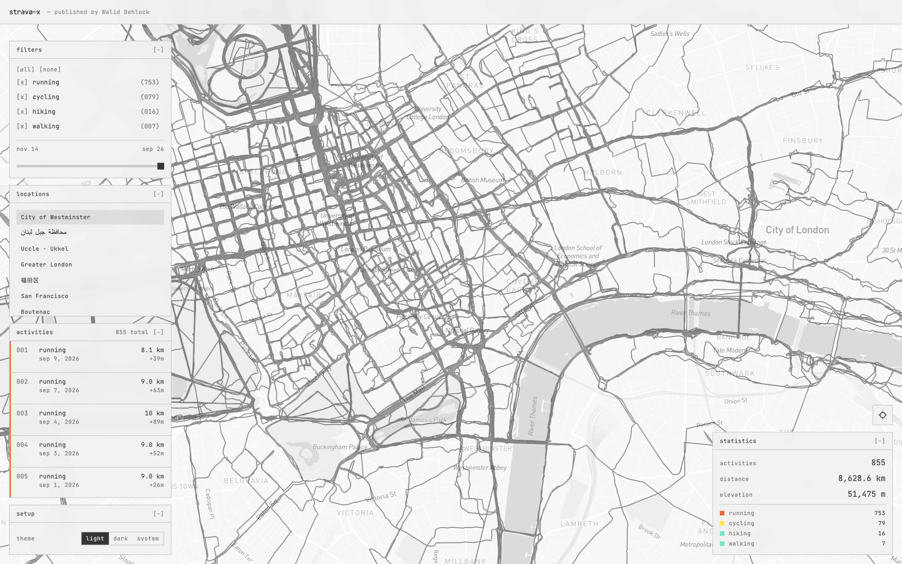

# strava-x

Bring your Strava activities together on one interactive map.

See familiar routes overlap, discover how much of a city you've explored, and share a map of the places you've been.



[Open strava-x](https://strava-x.com) · [Explore an example map](https://strava-x.com/walid)

## Getting started

1. Open [strava-x](https://strava-x.com) and choose **Connect your Strava**
2. Approve access to your activities in Strava, including activities set to **Only You**
3. Wait for your activities to sync. Routes appear as they load, so larger histories may take a moment

You can also [explore the example map](https://strava-x.com/walid) without connecting an account.

## Usage

### Explore your activities

- Use **Filters** to show running, cycling, walking, and hiking, or move the date slider to see activities up to a chosen date
- Choose a place in **Locations** to move the map to that area
- Select an activity in the list to zoom to its route and see its date, distance, and elevation gain
- Switch between light and dark maps in **Setup**

Activities need route data from Strava to appear on the map. Indoor activities and other activities without a recorded route can still appear in the list.

### Publish a map

1. With Strava connected, open **Share → Publish map**
2. Choose an available slug for your link, such as `strava-x.com/your-name`, and publish
3. Copy the link to share your interactive map

Published maps are snapshots. Open the same dialog and choose **Republish** to include your latest synced activities, or **Unpublish** and confirm to remove the map.

Publishing shares all synced activities, including private activities returned by Strava, regardless of your current filters.

## Local development

### Installation

1. Clone the project, install dependencies, and copy the environment template
   ```sh
    git clone https://github.com/behlock/strava-x.git
    cd strava-x
    npm ci
    cp .env.local.example .env.local
   ```
2. Configure `.env.local`
   - Create a [Mapbox access token](https://account.mapbox.com/access-tokens/) and set `NEXT_PUBLIC_MAPBOX_ACCESS_TOKEN`. Keep the supplied light and dark map styles, or replace them with your own
   - Create a [Strava API application](https://www.strava.com/settings/api) and set `NEXT_PUBLIC_STRAVA_CLIENT_ID` and `STRAVA_CLIENT_SECRET`
   - Set the Strava application's **Authorization Callback Domain** to `localhost`, following the [Strava setup guide](https://developers.strava.com/docs/getting-started/)
   - Set `NEXT_PUBLIC_APP_URL=http://localhost:3000`. The OAuth callback is `http://localhost:3000/api/auth/strava/callback`
3. Start the app

   ```sh
    npm run dev
   ```

   Open [localhost:3000](http://localhost:3000) and connect Strava.
